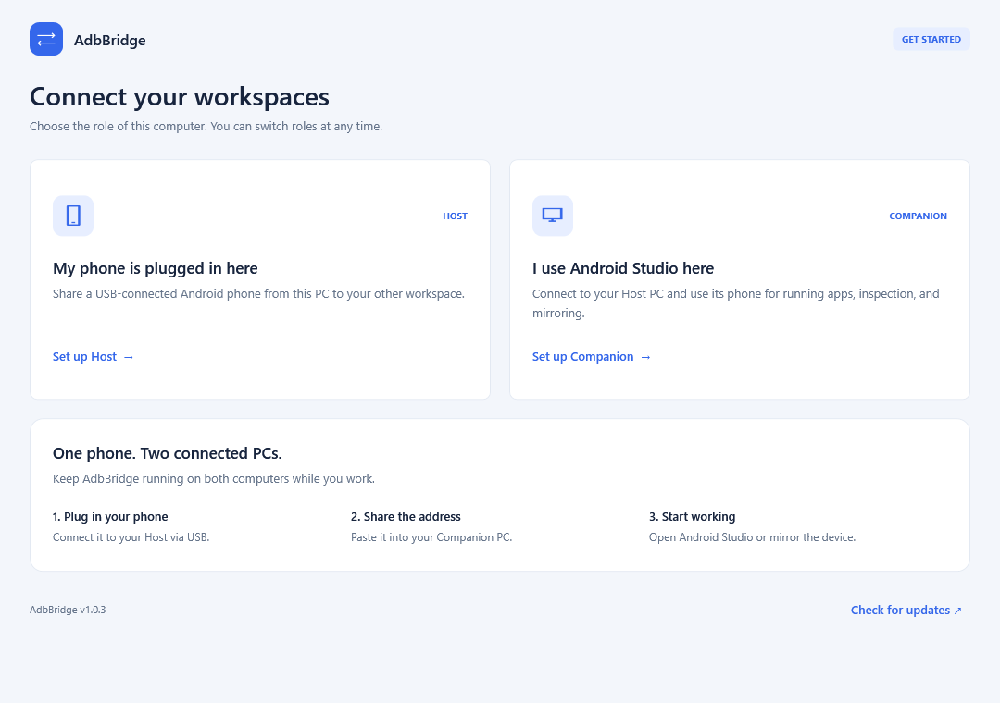
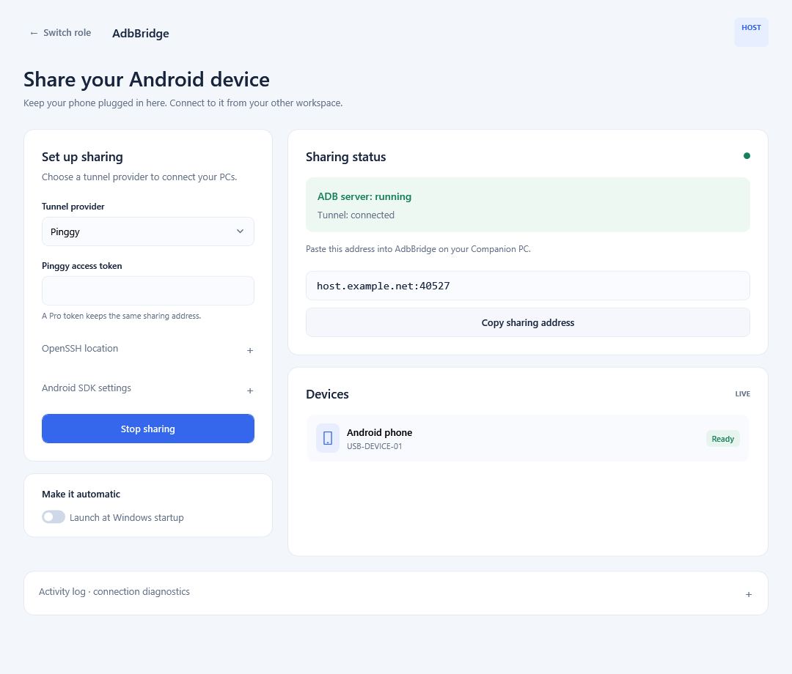
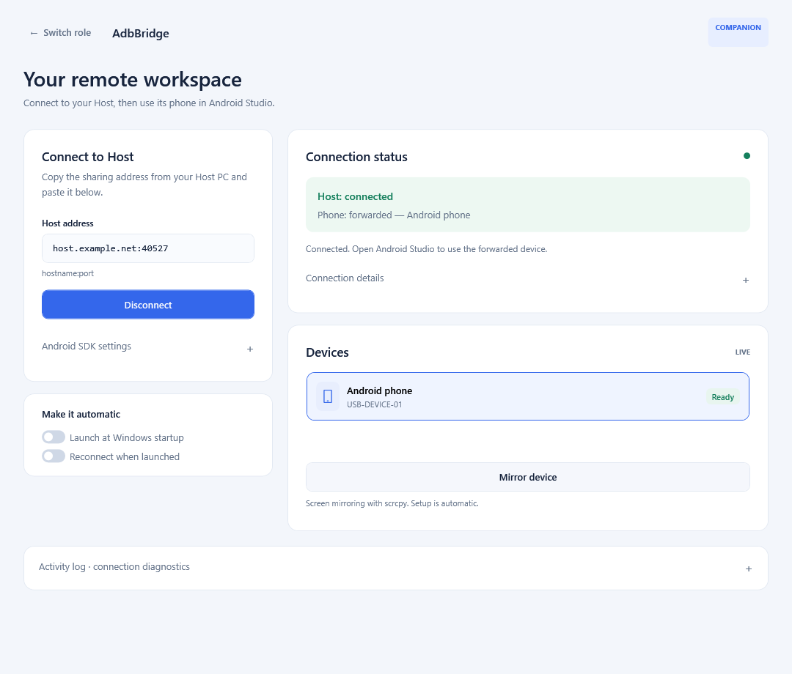

# AdbBridge

[Download the latest Windows release](https://github.com/blezDev/adbbridge/releases/latest) · [What's new](CHANGELOG.md) | [Security](SECURITY.md)

## v1.0.5 security update

**Update both Host and Companion before reconnecting.** Earlier versions use an
incompatible unauthenticated transport. v1.0.5 requires a new private connection code;
a bare `host:port` address is no longer accepted on Companion.

1. Stop sharing on Host and update both PCs using **Update and restart**, or download
   and extract the Windows ZIP.
2. Start sharing on the updated Host and click **Copy connection code**.
3. Transfer the entire `adbbridge://...` code privately to your trusted Companion,
   paste it into **Secure connection code**, and connect.

The code contains a client private key and the Host certificate fingerprint. Anyone
with the code can access the shared phone through ADB. Keep it out of screenshots,
public issues, logs, and shared clipboard history. Host's **Reset pairing** disconnects
Companions and invalidates all old codes; start sharing again and redistribute the new
code only to trusted PCs. Pairing certificates expire after five years; reset pairing
to renew them.

This release adds mutually authenticated TLS 1.2/1.3 with certificate pinning, restricts
the broker to ports registered by successful ADB forwarding commands, keeps Host ADB
on loopback, removes provider tokens from process arguments, and hardens update and
scrcpy extraction. Saved pairing credentials use Windows DPAPI. See [Security](SECURITY.md)
for audit scope, validation, and remaining trust assumptions. Previously stored provider
tokens or old diagnostic logs should be reviewed; rotate tokens if they were exposed.

## Screenshots

The updated interface uses consistent controls and live status cards across all
screens. These v1.0.3 UI previews are rendered from the app's layouts with sample connection
and device data.

**Choose this computer's role**



**Host — share a USB-connected phone**



**Companion — connect, inspect, and mirror**



## About

A single Windows app that lets Android Studio, running on a Cloud PC with no USB
access, see a phone plugged into a separate Local PC.

One `AdbBridge.exe`, copied to both machines. On launch it asks what this PC is:

- **Host** — the PC with the phone plugged into it over USB.
- **Companion** — the PC Android Studio runs on.

The Companion screen continuously shows two independent, auto-updating facts:
- **Host: connected / unreachable / checking…** — is the tunnel actually reaching the
  Host's real adb server right now.
- **Phone: forwarded / not detected / present but not ready** — is a device actually
  showing up through that connection, and in what state.

Saved provider tokens are encrypted with Windows DPAPI and are excluded from process
arguments. ngrok receives its token through the child environment; Pinggy uses a
restricted temporary SSH configuration, deleted on normal disposal. Pinggy SSH uses
trust on first use with a persisted known_hosts file and rejects subsequent key changes.

On startup the app checks GitHub Releases for a newer
version and shows a dismissible **Update and restart** banner when one is available.
Click it to download and install the update inside the app, without opening a browser.

The updater verifies the release archive against `SHA256SUMS.txt` and checks the
executable version before stopping the bridge. It replaces the current executable,
keeps `AdbBridge.exe.previous` as a backup, and restarts in the same Host or Companion
role. Existing settings are preserved. Host sharing must be started again after
restart; Companion reconnects if its saved auto-connect setting is enabled.
Downloads show progress and can be canceled before installation. A failed download or
checksum check leaves the installed executable untouched. If replacement or launching
the new executable fails, the installer attempts to restore and relaunch the previous
version. Run the app from a writable folder; updating a protected installation folder
requires moving it to a writable location first.

**Upgrading from a build that only offers View release:** download the latest Windows
release manually once. Subsequent newer versions use the in-app installer.

## Prerequisites

- **.NET 8 SDK** on whichever machine you build on — https://dotnet.microsoft.com/download/dotnet/8.0
  (this repo builds a standalone `.exe`, so the *other* machine only needs the published
  `.exe`, not the SDK or even the .NET runtime).
- Local PC (Host role): `adb.exe` from any platform-tools install, plus **one** tunnel
  provider:
  - **ngrok** — account + authtoken (free plan is fine) — https://dashboard.ngrok.com/get-started/your-authtoken,
    and `ngrok.exe`. Free-plan addresses change on every restart (handled automatically,
    but you'll re-paste into the Companion screen each time).
  - **Pinggy** — account + token — https://dashboard.pinggy.io. Uses the OpenSSH client
    that ships with Windows 10/11 (`C:\Windows\System32\OpenSSH\ssh.exe`), no extra
    binary needed. A **Pinggy Pro** token gives a persistent address that never changes
    across Host restarts, which free-tier ngrok can't do.
- Cloud PC (Companion role): the `adb.exe` path Android Studio actually uses (its
  bundled SDK platform-tools, e.g. `...\AppData\Local\Android\Sdk\platform-tools\adb.exe`).

## Build

```bash
dotnet build AdbBridge.sln -c Release
```

To produce a standalone, single-file executable (no .NET runtime needed on the target
machine):

```bash
dotnet publish src/AdbBridge.App/AdbBridge.App.csproj -c Release -r win-x64 --self-contained true -p:PublishSingleFile=true
```

The published `AdbBridge.exe` lands under
`src/AdbBridge.App/bin/Release/net8.0-windows/win-x64/publish/` — copy that one file to
both the Local PC and the Cloud PC. Prebuilt releases are also available under
[Releases](../../releases).

## Usage

The app opens with a guided Host/Companion chooser. Each workspace separates setup
from live connection status and device cards. Android SDK paths and connection
diagnostics are expandable; the activity log stays collapsed until needed. On
Companion, press Enter in the secure connection code field to connect. Device selection is
retained during refresh, and **Mirror device** becomes available when a phone is ready.

Launch `AdbBridge.exe` on both machines. Pick **Host** on the Local PC (phone attached)
and **Companion** on the Cloud PC (Android Studio). Configure each once — settings are
saved for next time — then leave both running (minimize to tray) for the session.

## How to Use

1. Launch `AdbBridge.exe` on both machines. Pick **Host** on the Local PC (phone
   attached) and **Companion** on the Cloud PC (Android Studio).

**Host screen (Local PC):**
1. Fill in the `adb.exe` path, pick a **Tunnel provider** (ngrok or Pinggy), and fill in
   that provider's path/token fields (saved after first run).
2. Click **Start Sharing**. Once the status panel shows the tunnel connected, copy the
   entire private connection code shown (`adbbridge://...`).
3. Confirm your phone shows up in the local device list.

**Companion screen (Cloud PC):**
1. Launch this *before* opening Android Studio (or restart Studio after connecting).
2. Confirm the `adb.exe` path matches the one Android Studio uses.
3. Paste the private connection code from the Host screen and click **Connect**.
4. Watch the status panel: wait for **Host: connected** and **Phone: forwarded —
   `<model>`**. That confirms the relay + tunnel are working end-to-end before you
   even touch Android Studio.
5. Open Android Studio — it should detect the device automatically.

Leave the app running (minimize to tray) on both machines for the rest of the session.
With ngrok free plan or a Pinggy free tunnel, the address changes on every Host restart
— re-copy the new connection code into the Companion screen and hit Connect again; everything
else recovers automatically. With a **Pinggy Pro** token the address is persistent, so
this step goes away entirely.

**Run at Windows startup:** checking this box on either screen registers
`AdbBridge.exe host` or `AdbBridge.exe companion` (not the bare exe) in the Windows
startup Run key, so a relaunch after login goes straight to that screen instead of the
role picker. On the Companion screen, also checking **Auto-connect on startup** will
reconnect automatically using the last private connection code you entered, without any click.

## Device Mirroring and App Inspection

### Mirroring inside Android Studio

Keep Host and Companion connected, then open **View > Tool Windows > Running Devices**
in Android Studio and select the phone. Native Studio mirroring and App Inspection were
confirmed working by the user on v1.0.4; Studio mirroring is somewhat slower than scrcpy.
The bridge's reverse tunnels carry Studio's
screen-sharing agent connections; scrcpy is not required for this mode.

If Studio's agent exits while using the phone's VP8 encoder (observed on the Infinix
X6815B), switch Studio's own video codec to H.264. Open **Help > Edit Custom Properties**
and add:

```properties
device.mirroring.video.codec=avc
```

Restart Android Studio and start mirroring again. The agent launch command in
Studio's `idea.log` should now contain `--codec=avc`. This is an internal Studio
feature flag and may change between versions. Remove the line and restart to restore
Studio's default codec. The setting applies to physical-device mirroring across the IDE.
H.264 avoids the failing VP8 codec, but still requires a working H.264 encoder on the
phone; successful rendering must be checked on the actual device.

### Optional standalone scrcpy window

On Companion, select a ready device and click **Mirror device**. AdbBridge looks for
a complete scrcpy installation in its saved location, beside the app (including a
`scrcpy` subfolder), in its managed tools folder, and on PATH. If none is found, it
automatically downloads the official scrcpy 5.0.1 Windows x64 package, verifies its
published SHA-256 checksum, and installs the full package under
`%LOCALAPPDATA%\AdbBridge\tools\scrcpy`. No file picker, administrator access, or
separate installer is required. Setup shows download progress and can be canceled
with the same button. The saved executable is reused on subsequent launches.
Mirroring opens in scrcpy's own window and logs startup errors in the Companion log.

This uses scrcpy's forward-tunnel mode through the bridge, with H.264, a maximum
dimension of 1280 pixels, 30 FPS, and audio disabled. It provides an alternative for
phones whose VP8 encoder fails with Android Studio's screen-sharing agent. It does
not change Studio's built-in mirroring implementation. Close the scrcpy window before
disconnecting the bridge.

For App Inspection, use a running debuggable app in Android Studio. Forward mappings
are announced only after both ADB service acceptance and forwarding-operation success;
allocated `tcp:0` ports are read after those two statuses. Failed mappings do not open
Companion listeners.

Protocol and security regression checks (no phone or external test packages required):

```powershell
dotnet run --project tests/AdbBridge.ProtocolTests -c Release
dotnet run --project tests/AdbBridge.SecurityTests -c Release
dotnet run --project tests/AdbBridge.RelayTests -c Release
dotnet run --project tests/AdbBridge.UpdateTests -c Release
dotnet run --project tests/AdbBridge.ScrcpyTests -c Release
```

Plain adb commands (`shell`, `logcat`, `install`, `push`, and even the `adb forward`/
`adb reverse` commands themselves) all ride inside the single relayed connection to the
adb server, so they worked from day one. Android Studio's **Layout Inspector**,
**Network/Database Inspector**, **profilers**, and **Device Mirroring** also need
Studio to reach a TCP port or receive a connection *directly*, bypassing the adb server
protocol entirely — and by default only the adb server's own port was tunneled, so those
connections found nothing on the Companion side and the feature failed silently even
though the underlying `forward`/`reverse` command reported success. Two separate
mechanisms close that gap, since adb uses both:

- **`adb forward`** (Layout Inspector, Network/Database Inspector, profilers) makes the
  real adb server — which runs on the Host, next to the USB device — open a *new* TCP
  listener, and Studio connects to that port directly. `ForwardBroker` (Host) and
  `ForwardPortRelay` (Companion) watch the adb protocol for `forward:`/`killforward`
  requests, and for each one open a matching local listener on Companion that tunnels
  through to the real forwarded port on Host.
- **`adb reverse`** (Device Mirroring's connection to its on-device
  screen-sharing-agent) is the mirror image: the real adb server dials *out* to a port
  on whichever machine it runs on (Host) when the device connects to its own local
  socket — but Studio's receiving listener lives on Companion, where the command was
  issued. There's no listener to wrap here, since the real adb server is the one
  dialing out, so `ReversePoolRelay` (Companion) keeps a small pool of pre-opened,
  marker-tagged tunnel connections sitting ready on the Host side at all times;
  `ForwardBroker`'s reverse handling pairs each genuine device-originated reverse-connect
  with one of them and signals `GO` before Companion dials Studio's real local listener —
  so Studio never sees a connection that isn't backed by a real one.

Both are best-effort protocol parsing (not a supported adb API), so a future adb version
that changes the wire framing could degrade this back to the old behavior — the
underlying `forward`/`reverse` command would still succeed, but Studio's direct
connection to it wouldn't be tunneled.

Forwarding-rule lifetime and stream lifetime are separate: removing a forward or
reverse mapping stops new connections while established streams remain alive. This
matters because scrcpy and Studio can remove setup mappings immediately after their
sockets connect. Disconnecting Companion closes all retained streams. Reverse slots
are replenished after connecting locally, preserving video/control arrival order
without limiting how many established streams can run at once.

Separately, `TcpRelay` also intercepts `host:kill` (the wire form of `adb kill-server`)
from the Companion's local adb client and answers it locally instead of forwarding it —
Android Studio's own adb housekeeping issues this routinely as part of normal reconnect
logic, and forwarding it through the tunnel would actually kill the Host's real adb
server (and the phone's USB session) rather than a harmless local one.

Both apps also write a rolling log to `%LOCALAPPDATA%\AdbBridge\logs\{host,companion}.log`
(overwritten fresh each run) in addition to the in-app log panel, useful for diagnosing a
connection issue after the fact.

**Note:** codec errors around agent shutdown do not by themselves prove a phone hardware
failure: prematurely closing an established stream can also trigger codec teardown
errors. Live scrcpy tests with the stream-lifetime fix completed in both forward and
reverse mode. Native Studio mirroring must be retested separately before claiming
that its device-specific issue is resolved.

## Known limitations

- **No fully automatic address handoff on free tiers.** Unless you're on Pinggy Pro (or
  a paid ngrok reserved address), the tunnel address changes on restart and there's no
  domain to publish a stable one to, so you'll re-paste the address into the Companion
  screen. A natural follow-up (not built) is having the Host screen publish its address
  somewhere the Companion screen can poll — e.g. a private GitHub Gist — if this becomes
  annoying on a free plan.
- **Cloudflare Tunnel isn't wired in yet.** `ITunnelProvider` is designed so it can be
  added later, but raw TCP through Cloudflare needs Zero Trust + a domain you don't
  currently have. `CloudflareTunnelProvider` is a documented stub for when that changes.
- **Pinggy's SSH login prompt.** Pinggy's tunnel endpoint doesn't do real password auth,
  but `ssh.exe` occasionally still waits on a prompt when it can't attach a real
  terminal; `PinggyTunnelProvider` sends a blank line on connect to get past this. If a
  particular OpenSSH build still hangs, check the Host screen's log — the raw ssh output
  is echoed there.
